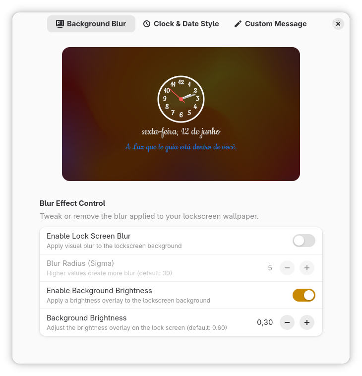
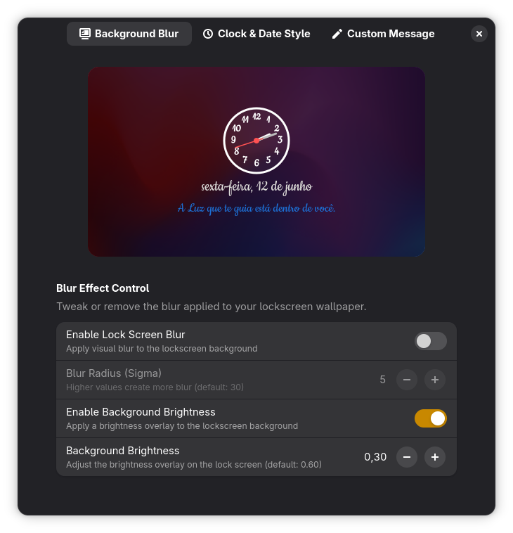
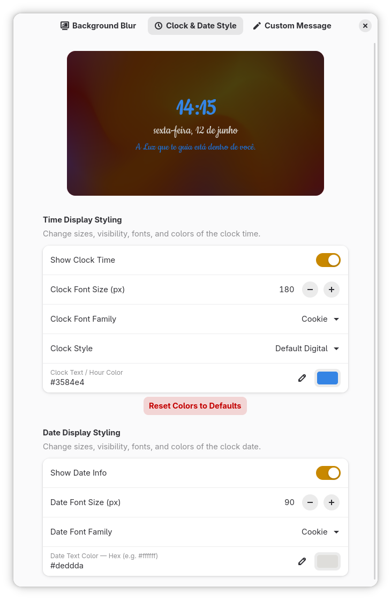
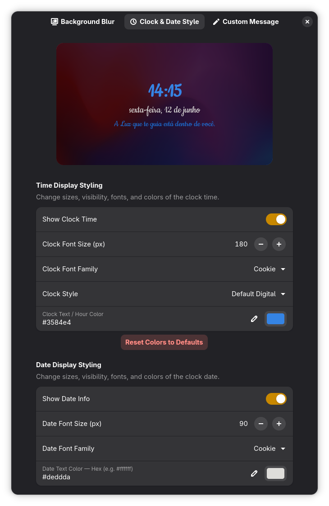
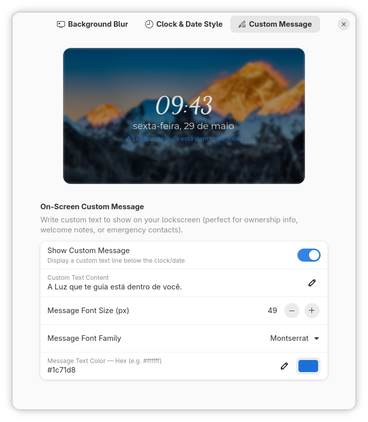
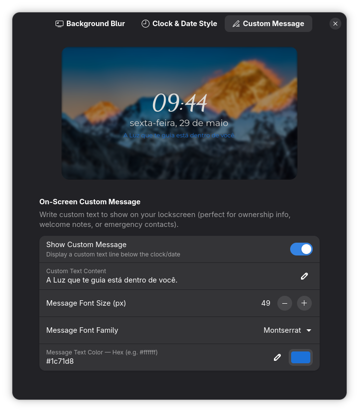

# 🌟 Lockscreen Studio 🌟

A modern and premium GNOME Shell extension to fully customize and control your lock screen experience. Compatible with **GNOME 45, 46, 47, 48, 49, 50, and 51**.

Built completely with **ES Modules (ESM)** and optimized for modern GNOME design guidelines using GTK4 and Libadwaita.

---

## 📸 Screenshots

### Blur Control
| Light Mode | Dark Mode |
|:---:|:---:|
|  |  |

### Clock & Date Customization
| Light Mode | Dark Mode |
|:---:|:---:|
|  |  |

### Custom Message
| Light Mode | Dark Mode |
|:---:|:---:|
|  |  |

---

## ✨ Features

*   **🔮 Wallpaper Blur & Brightness**:
    *   **Blur** and **brightness overlay** are fully independent — enable one, both, or neither.
    *   Fine-tune the **blur radius** (sigma) dynamically.
    *   Adjust the **overlay brightness** (from completely dark to original wallpaper brightness).
*   **⏰ Clock Time Styling**:
    *   Toggle time visibility.
    *   Customize font sizes in pixels.
    *   Set custom **font families** (e.g. *Cantarell*, *Sans*, *Ubuntu*, *system-ui*).
    *   Change text color using Hex codes.
    *   **4 clock styles**: Default Digital, Separated Colors (Horizontal), Vertical Stack, and **Analog Clock**.
*   **🕐 Analog Clock** *(new in v1.1.0)*:
    *   Beautiful analog clock with hour, minute, and optional second hand.
    *   **3 skins**: **Classic** (numbers 1-12), **Minimalist** (elegant dots), **Accent** (bold uniform ticks + colored glow).
    *   Adjustable clock **diameter** (80–400px).
    *   Independent colors for hour hand, minute hand, second hand, numbers, and ticks.
    *   **Reset Colors** button to restore the harmonious default palette.
*   **📅 Date Display Styling**:
    *   Toggle date visibility.
    *   Set custom font sizes, families, and colors.
*   **✍️ On-Screen Custom Message**:
    *   Display a premium custom message below the lockscreen clock (welcome text, ownership info, emergency contact, or quotes).
    *   Adjust font size, family, and custom text color.
*   **👤 User Avatar & Auth Prompt Customization** *(Issue #2)*:
    *   Scale user icon/avatar size (from 32px up to 256px).
    *   Customize font family, font size, and color for username.
    *   Adjust font size and color for password input entry.
    *   Style auth/PAM status message typography.
*   **📐 Lockscreen Top Bar / Panel Scaling** *(Issue #2)*:
    *   Adjust top bar height (20–80px) and font size (8–40px) on the lock screen.
*   **🎨 Libadwaita Preferences**:
    *   Beautiful, premium, and native preferences window fully aligned with standard GNOME styles.
    *   Interactive controls (switches, adjust spinrows, and entries) that update settings in real-time.
    *   **Live preview** of the lock screen background with real-time clock rendering.

---

## 📁 File Structure

```
lockscreen-studio@pedro.projects/
├── metadata.json           # Extension descriptor and metadata
├── extension.js            # Main extension coordinator
├── prefs.js                # Preferences window coordinator
├── LICENSE                 # GNU General Public License v3.0 (GPL-3.0-or-later)
├── install.sh              # Automatic installation script
├── README.md               # Documentation
├── schemas/
│   ├── org.gnome.shell.extensions.lockscreen-studio.gschema.xml # Configuration GSchema
│   └── gschemas.compiled   # Compiled GSettings binary schema
└── src/
    ├── constants.js        # GSettings keys, clock styles & analog skins
    ├── extension/          # Shell-side modular components
    │   ├── backgroundManager.js # Wallpaper blur & brightness overlay (supports blur radius 0)
    │   ├── clockManager.js      # Clock styles, date & GLib interval timer
    │   ├── analogClock.js       # Analog clock skins, face, ticks & hands
    │   ├── customTextManager.js # On-screen custom message
    │   └── authPromptManager.js # User avatar, username, password & top bar scaling
    └── prefs/              # GTK4/Adwaita preferences modular pages
        ├── blurredBox.js        # Snapshot blur widget
        ├── helpers.js           # UI color pickers and font factories
        ├── wallpaperPreview.js  # Live lockscreen preview widget
        ├── pageBlur.js          # Background blur & brightness settings
        ├── pageClock.js         # Clock & date styling settings
        ├── pageCustomText.js    # Custom message settings
        └── pageAuth.js          # User & top bar scaling settings
```

---

## 📄 License

This project is licensed under the **GNU General Public License v3.0 or later** ([GPL-3.0-or-later](LICENSE)).

---

## 🚀 Installation & Activation

We've provided a simple installer script to copy the files to your local extension directory and compile the GSettings schemas automatically.

### 1. Run the installer script:
In this folder, execute:
```bash
./install.sh
```

### 2. Activate the Extension:
Since GNOME Shell caches extensions on startup, the activation process depends on your windowing system:

*   **Wayland (Default on modern distros)**:
    1. Log out of your session and log back in.
    2. Open **Extension Manager** or the **Extensions** app.
    3. Find **Lockscreen Studio** and toggle it **ON**.
    
*   **X11**:
    1. Press `Alt + F2`, type `r`, and press `Enter` to restart GNOME Shell.
    2. Enable the extension using:
       ```bash
       gnome-extensions enable lockscreen-studio@pedro.projects
       ```

---

## 🛠️ Technology & Architecture

*   **Monkey-Patching Prototypes**: Overrides the internal `UnlockDialog` prototype `_init` and `_updateBackgroundEffects` to intercept clock rendering and background blur styling.
*   **Dynamic Resource Release**: The `disable()` hook cleans up all active overrides, deletes custom properties, detaches added custom elements (like labels), and triggers the native background effects to restore the lock screen perfectly to its original state.
*   **Bidirectional Gio.Settings Binding**: Binds GTK4 preferences widgets directly to GSettings for zero-boilerplate state synchronization.

---

*Made with 💖 for GNOME Shell.*
